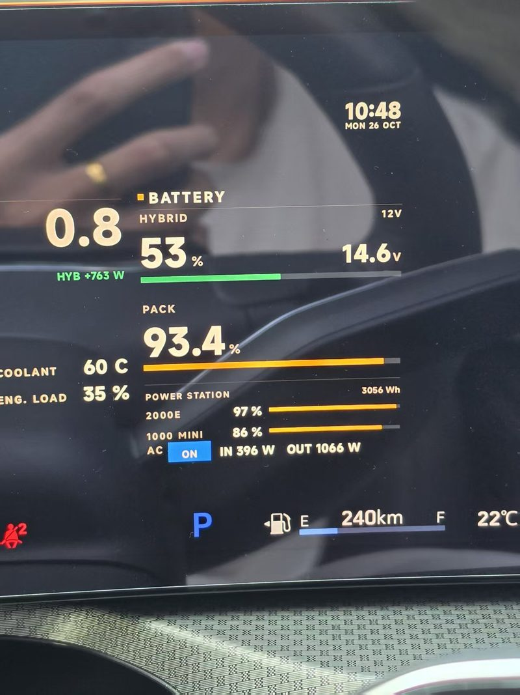
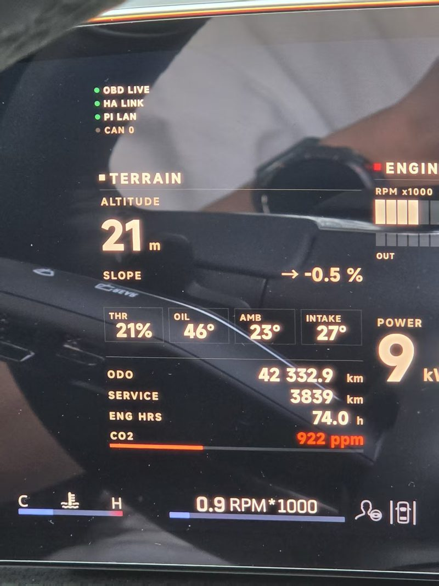
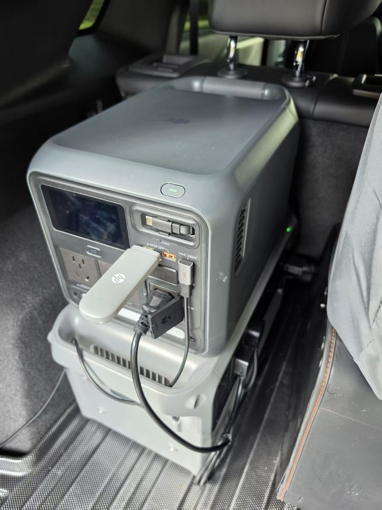
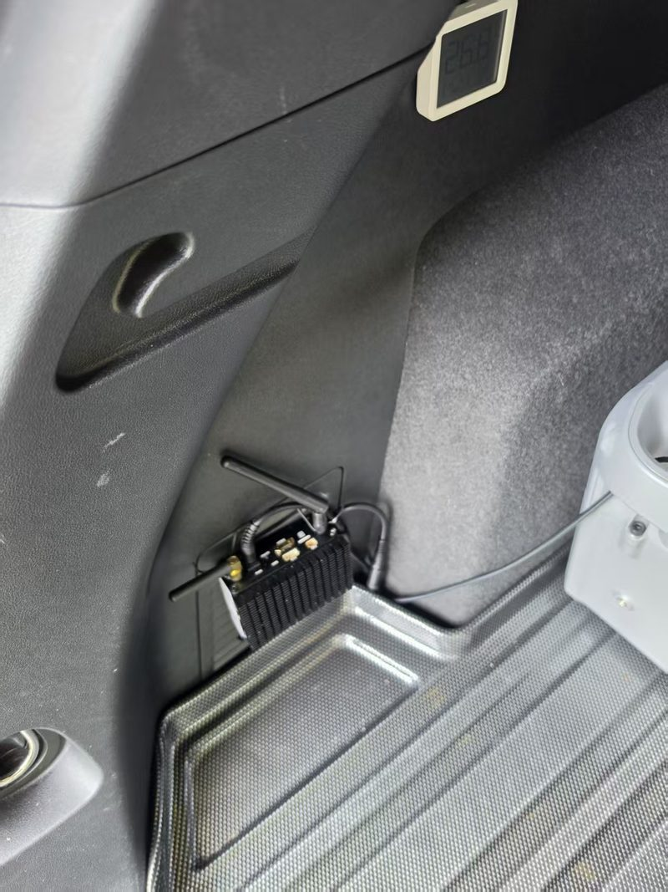

# Vehicle Stack — 一台 2025 款 XT5 车机的改造档案

> 这不是「一键复刻」模板，而是一份**实车技术档案**：记录我们怎么把原厂车机变成可编程终端，
> 哪些路走得通、哪些走不通、接口长什么样。
>
> **给 agent 的用法**：读完 → 理解链路 → 挑模块 → 按自己车型重写。**不要照抄命令当安装脚本。**
> 我们没有在干净环境里从零跑通过一遍。

[](LICENSE)

---

## 1. 效果

| | |
|---|---|
|  |  |
| HUD 电源页：SOC / PACK / 双电源 / AC 状态 / 功率 | HUD 地形页：`OBD LIVE` `HA LINK` `PI LAN` + 海拔坡度 |

| | |
|---|---|
|  |  |
| DJI Power 1000 mini + 4G 路由棒 | 后备箱 4CH 哨兵主机 |

**完整实拍（10 张，每张标注「证明了什么」）→ [`docs/GALLERY.md`](docs/GALLERY.md)**

---

## 2. 硬件清单

| 类别 | 选型 | 作用 |
| --- | --- | --- |
| 总电源 | **DJI Power 1000 mini**（1 kWh） | 全车设备供电，PD 口诱骗 12V |
| 计算 | **Pi Zero 2 W** | HUD 渲染 / 中继 / 自动 AC |
| 显示 | **3.7″ 240×960 条屏** + HDMI 驱动板 | HUD |
| 车机 | SA8155P（原车） | CastSink / ShellBridge |
| 哨兵 | **4CH AHD 360 DVR**（成品，无源码） | 四路环视 + 停车监控 |
| 诊断 | **Vgate iCar Pro 4.0 蓝牙 OBD** | 转速等 VHAL 拿不到的数据 |
| 联网 | 4G 路由棒 + **Tailscale** | 车内组网，不开放公网端口 |
| 走线 | 0.75mm² 12V 线 + AD28.5 波纹管 + 丁基胶带 + 硅橡胶 | 底盘走线、穿孔密封 |
| 外壳 | 3D 打印主体壳（[`hardware/cad/`](hardware/cad/)） | 上盖与遮光罩沿用旧件 |

**选型与价格 → [`hardware/BOM.md`](hardware/BOM.md)** ｜ **接线 → [`docs/WIRING.md`](docs/WIRING.md)** ｜ **安装 → [`hardware/INSTALL.md`](hardware/INSTALL.md)**

---

## 3. 软件实现

| 能力 | 实现 | 目录 |
| --- | --- | --- |
| 远程执行 shell / 读文件 / 装 APK（替代 adb） | ShellBridge（TCP 7801 行协议） | [`software/shellbridge`](software/shellbridge) |
| 手机/电脑画面投到车机 | CastSink（MediaProjection 接收端） | [`software/castsink`](software/castsink) |
| 车速/挡位/油量/续航（免 OBD） | VHAL 直读（22 属性实测） | [`software/headunit-vhal`](software/headunit-vhal) |
| 仪表盘 / 导航箭头 / 车速 | DIY HUD（PIL 直写 framebuffer） | [`software/hud`](software/hud) |
| 户外电源监控 | Power Monitor（BLE 本地，无云端） | [`software/power`](software/power) |
| 车启动开 AC、熄火关 AC | pi-auto-ac（电压判定 + 迟滞 + SOC 守卫） | [`software/power/pi-auto-ac`](software/power/pi-auto-ac) |
| Pi 中继 / 隧道 / OBD 桥 | Relay | [`software/relay`](software/relay) |
| 车机导航 TBT / 红绿灯 | 绑定厂商导航 Binder（含防卡顿规则） | [`docs/NAV-DATA.md`](docs/NAV-DATA.md) |
| GPS 海拔 / 坡度 | Android Location + 60s 窗口差分 | [`docs/GPS-ALT-SLOPE.md`](docs/GPS-ALT-SLOPE.md) |
| 48V 轻混实时功率（**估算**） | HybridPower（物理模型 + SOC 锚点修正） | [`docs/48V-HYBRID.md`](docs/48V-HYBRID.md) |
| 停车监控 | 成品 4CH DVR（无源码） | [`software/sentinel`](software/sentinel) |
| 另一种 HUD 方案（已退役） | C2-Elite HUD，480×240，设备有 ADB | [`alternatives/c2-elite-hud`](alternatives/c2-elite-hud) |

数据流 → [`docs/ARCHITECTURE.md`](docs/ARCHITECTURE.md) ｜ 自动 AC 策略 → [`docs/AUTO-AC.md`](docs/AUTO-AC.md)

---

## 4. 硬结论（这份档案最值钱的部分）

| 结论 | 说明 |
| --- | --- |
| **车机开不了 ADB** | 装 App 只能 U 盘拷 APK + 文件管理器手动装 |
| **VHAL 可读 22 属性** | 车速/挡位/油量/续航/点火/手刹；挡位是位掩码 `1=N 2=R 4=P 8=D`，`CURRENT_GEAR 16=D1` |
| **别抄网上的 VHAL ID** | 车机 jar 里常量 `ENGINE_RPM=0x11600305`、`SPEED=0x11600209`（与资料差 1~2），但**常量存在 ≠ 能读到**：RPM 实测 0.0 / null。必须运行时枚举 |
| **转速 VHAL 里没有** | 22 属性订阅 12 秒 0 事件；四条路（VHAL / patacframework / PatacService / FSA）全空 → 买 OBD |
| **里程读不到** | `CAR_MILEAGE` 是 signature&#124;privileged |
| **原厂仪表改不了** | HMI 通道需平台签名，第三方 `isClusterServiceReady=false` |
| **HUD 用 fb0 直写** | 240×960 / 16bpp，延迟 <50ms |
| **自动 AC 看电压** | 13.2V 开、13.0V 关（实测着车 13.8–14.6V，熄火回落 12.6V） |

完整复盘 → [`docs/HOW-WE-BUILT-IT.md`](docs/HOW-WE-BUILT-IT.md)

---

## 5. 边界（别当承诺）

| 我们做过 | 我们没做过 |
| --- | --- |
| 在自己的 XT5 2025 上实车验证 | ❌ 干净环境从零构建 |
| 各模块跑通并存图 | ❌ 其他车型适配（CT5/其他 8155 未测） |
| 脱敏后公开源码 | ❌ 自动化测试（验收靠人眼） |
|  | ❌ 7801 鉴权（只在 Tailscale 内网用） |

---

## 6. 怎么用这份档案

**给人**：先看 [`docs/HOW-WE-BUILT-IT.md`](docs/HOW-WE-BUILT-IT.md) 建立全局感，再挑你要的模块读源码。

**给 agent**：先读 [`AGENTS.md`](AGENTS.md)（阅读顺序、可复用 vs 要重写、硬结论、别做的事）。

**要自己开发**：不用照抄整套。最有用的三份是 VHAL 属性表、ShellBridge 命令协议、自动 AC 策略。

---

## 7. 目录

```
vehicle-stack/
├── AGENTS.md              # 给 agent 的导读：读什么、复用什么、别做什么
├── docs/
│   ├── HOW-WE-BUILT-IT.md # ★ 全景复盘（先看这个）
│   ├── ARCHITECTURE.md    # 拓扑与端口
│   ├── VHAL-22.md         # 车机原生数据实测
│   ├── AUTO-AC.md         # 自动 AC 策略
│   ├── WIRING.md          # 接线示意
│   ├── GALLERY.md         # 实拍证据
│   ├── TROUBLESHOOTING.md # 我们撞过的墙
│   ├── NAV-DATA.md        # 导航 TBT 链路与防卡顿规则
│   ├── OBD-ARCHITECTURE.md# OBD 采集架构（Vgate + Pi + HA）
│   ├── HUD-RENDERER.md    # HUD 渲染与 Pi 稳定性
│   ├── HUD-MAP-RENDERING.md # 地图渲染选型
│   ├── CARBRIDGE.md       # 车机双 App 合并与运维
│   ├── CASTSINK-TUTORIAL.md # 投屏接收端原理拆解
│   └── RELEASE.md
├── hardware/              # BOM、安装、实拍
├── software/              # 模块源码
├── ha/                    # HA 示例包
└── tools/                 # sanitize / fetch-toolchain / preflight / e2e
```

---

## 兼容性

| 车型 | 年款 | 车机 | 状态 |
| --- | --- | --- | --- |
| 凯迪拉克 XT5 | 2025 | SA8155P / Android 12 | ✅ 实车验证（本档案来源） |
| 其他 8155 / 8295 | — | — | ⚠️ 未验证，需重新枚举 VHAL 与 SELinux 策略 |

## 许可证

MIT（见 `LICENSE`）。

## 免责声明

所有改动均在你自己的车辆上进行，风险自负。作者不承担因改装导致的车辆损坏、保修失效或事故责任。