# 实拍证据

> 这些图不是效果图，是车上真实跑出来的。每张下面写了**它证明了什么**——复刻时拿它当验收基准。
> 照片里的里程/保养里程是真实数据（约 4.2 万 km）。如需匿名，替换 `docs/gallery/` 下同名文件即可。

## 1. HUD · 电源页（AC 开启，带载）
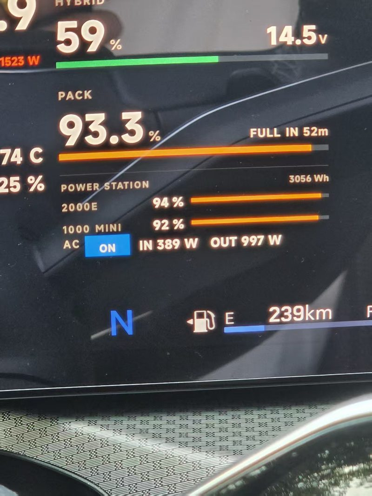

- SOC 59%、PACK 93.3%、电池组 14.5V
- 两台电源并列：`2000E 94%` / `1000 MINI 92%`
- **AC ON，IN 389W / OUT 997W**

**证明**：BLE/云双通道同时取数；AC 状态能回显；两台设备可共存。

## 2. HUD · 电源页（AC 关闭）
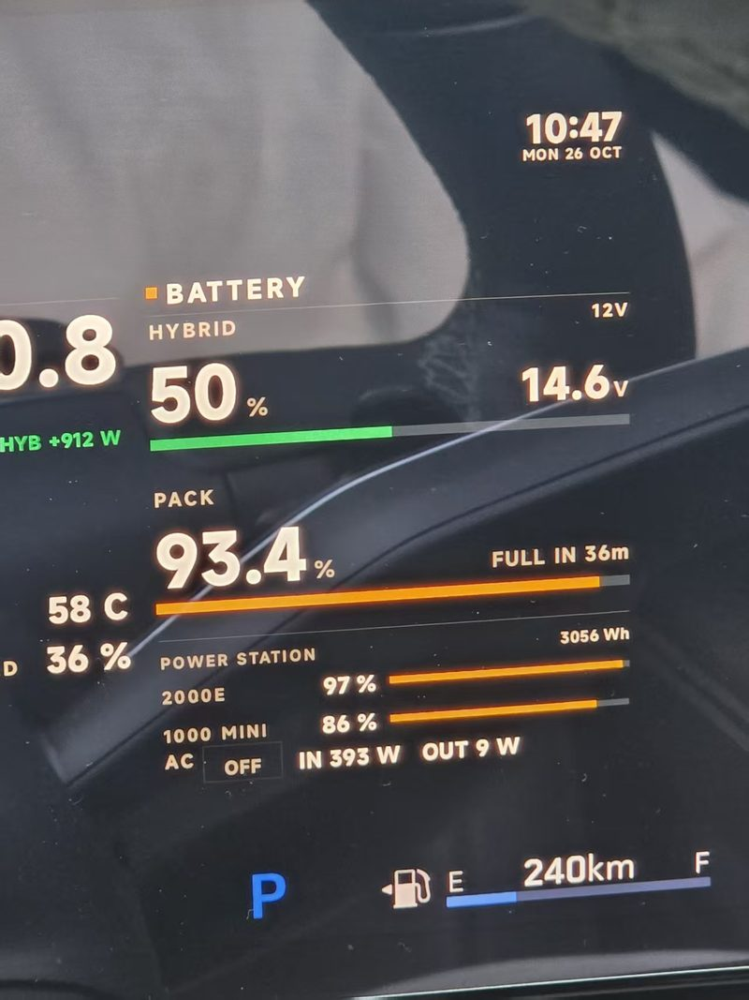

- `AC OFF`，`OUT 9W`（DC 口负载：哨兵 DVR + Pi Zero 2 W）

**证明**：AC 开关是真断电，不是 UI 假状态。AC 关掉后仍有 9W，那是**哨兵 DVR + Pi Zero 2 W 的 DC 口负载**，不是逆变器待机损耗。

## 3. HUD · 电源页（AC 开启 + 发动机数据）
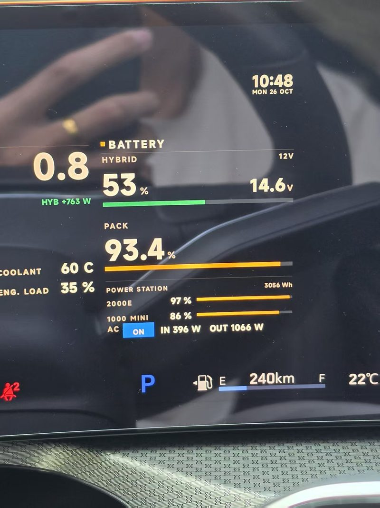

- `AC ON`，`IN 396W / OUT 1066W`
- 冷却液 60°C、发动机负荷 35%

**证明**：电源数据与 OBD 数据同屏刷新，互不阻塞。

## 4. HUD · 地形页（三链路全绿）
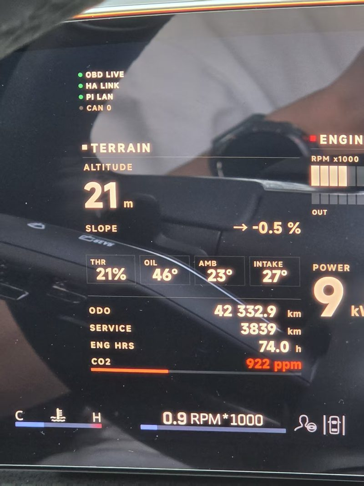

- 顶部状态：`OBD LIVE` / `HA LINK` / `PI LAN` 全绿，`CAN 0` 灰
- 海拔 21 m、坡度 -0.5%、节气门 21%、油温 46°C、进气 27°C、功率 9 kW

**证明**：三条数据链路同时在线；CAN 直读不通（灰灯），所以走 OBD——这就是为什么要买蓝牙 OBD。

## 5. HUD · 轰油门后
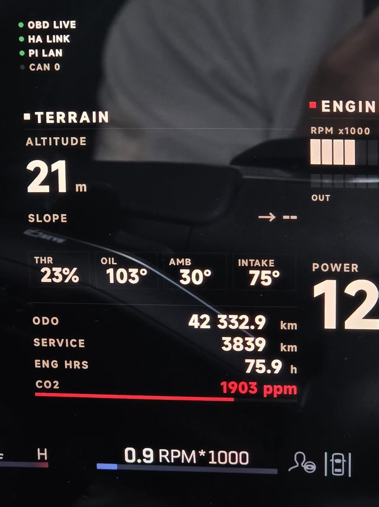

- 油温 103°C、CO2 1903 ppm、转速 0.9k

**证明**：数值是实时的，不是静态贴图。

## 6. 动态抽帧
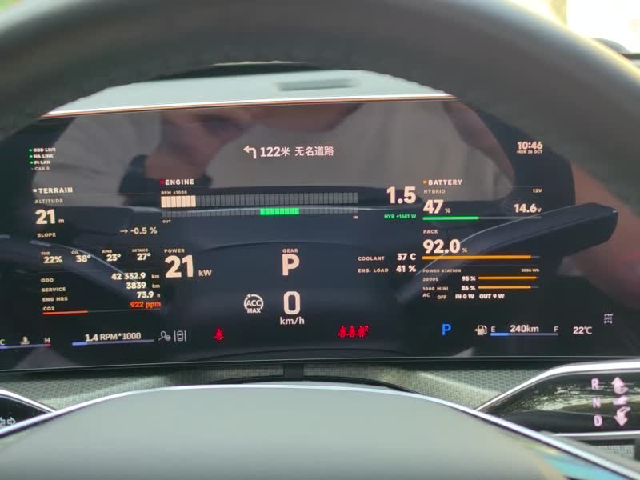

**证明**：整屏刷新（视频原片 10 秒，车辆 P 挡轰油门，功率与转速同步跳动）。

## 7. 车上供电形态
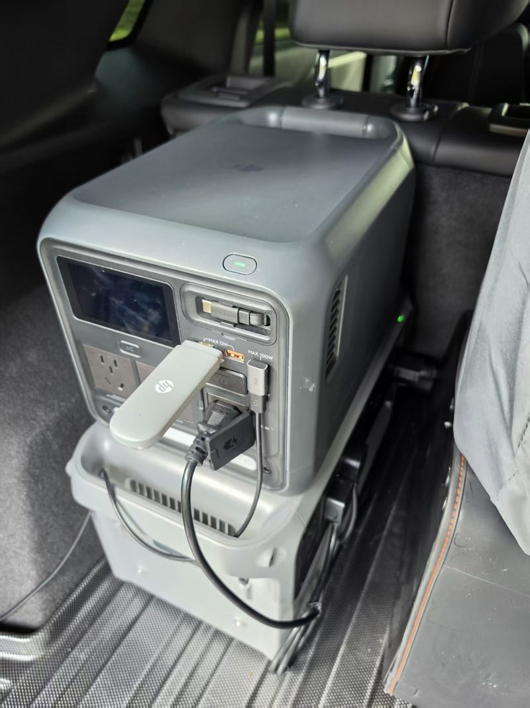

- DJI Power 1000 mini 放后排脚位
- USB 口插 **HP 4G 路由棒**
- DC 线引出到车内

**证明**：供电方案的实际形态；路由棒靠电源 USB 供电，不需要单独取电。

## 8. 哨兵主机安装位
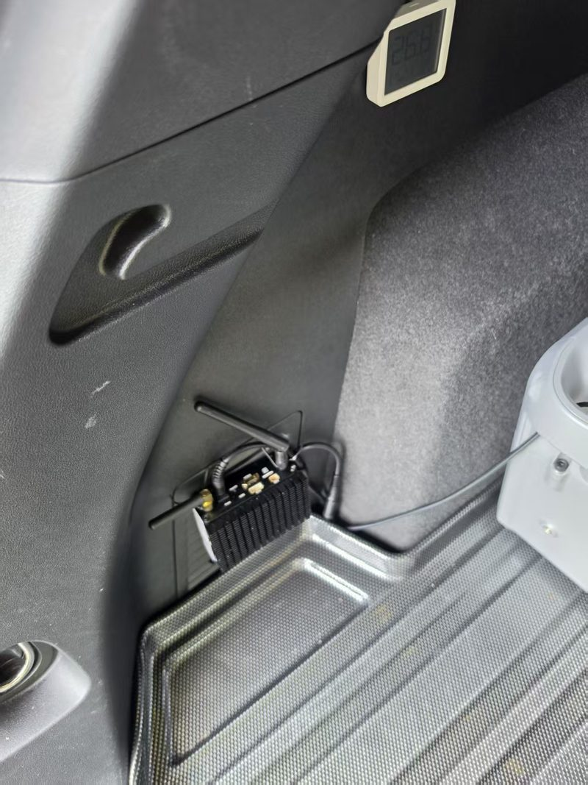

- 4CH DVR 固定在后备箱侧壁凹槽，天线朝上

**证明**：哨兵是**开箱即用**的成品件，独立 12V 供电，不依赖本仓库代码。

## 9. 侧向摄像头
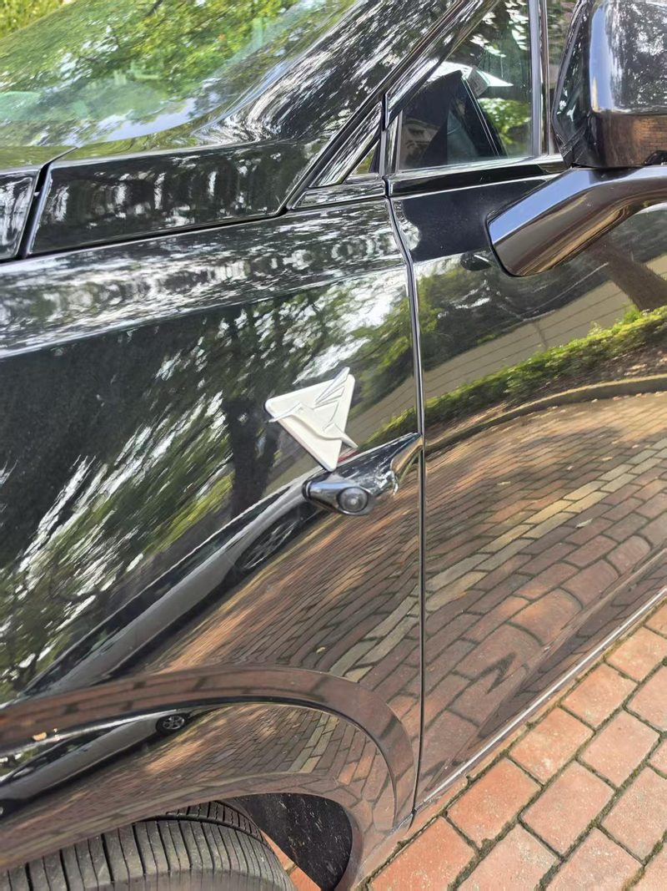

- 后视镜下方打孔安装的侧向摄像头

**证明**：360 环视的布点方式（前/后/左/右四路）。

## 10. 负极接点（电瓶桩头）
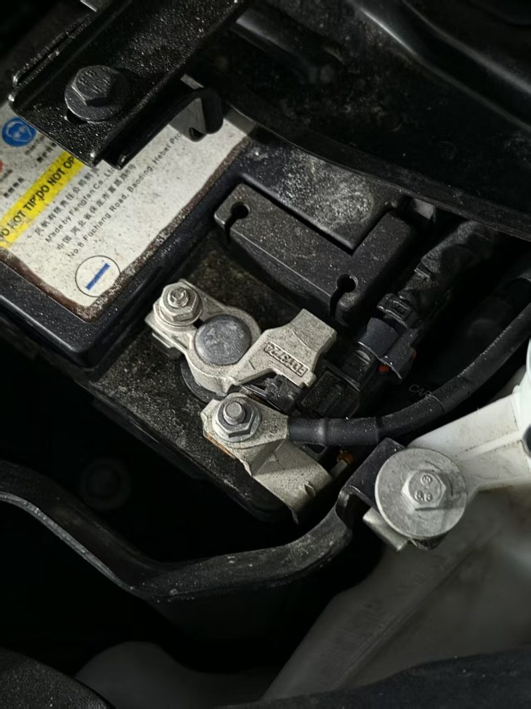

- 负极线用螺栓直接压在**电瓶负极桩头**上（不是车身钣金搭铁）

**证明**：整车共地取在电瓶负极，避免多点接地造成回路干扰。正极必须经保险。

## 11. 导航 TBT 上屏
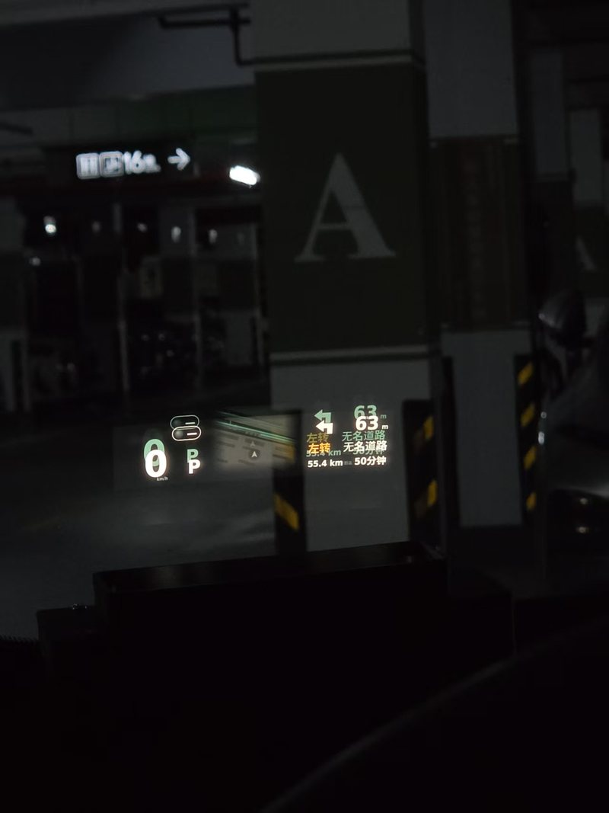

- 左转图标 + `63 m` + 路名「无名道路」
- 底部 `55.4 km · 50 分钟`（剩余里程/时间）
- 左侧车速 `0 km/h`、挡位 `P`

**证明**：导航 TBT（转向、距离、路名、剩余里程与时间）能实时上屏，且与车速/挡位同屏刷新。
这张是在地库拍的——没有 GPS 信号，数据全部来自车机导航服务的 Binder 回调（见 `docs/NAV-DATA.md`）。
