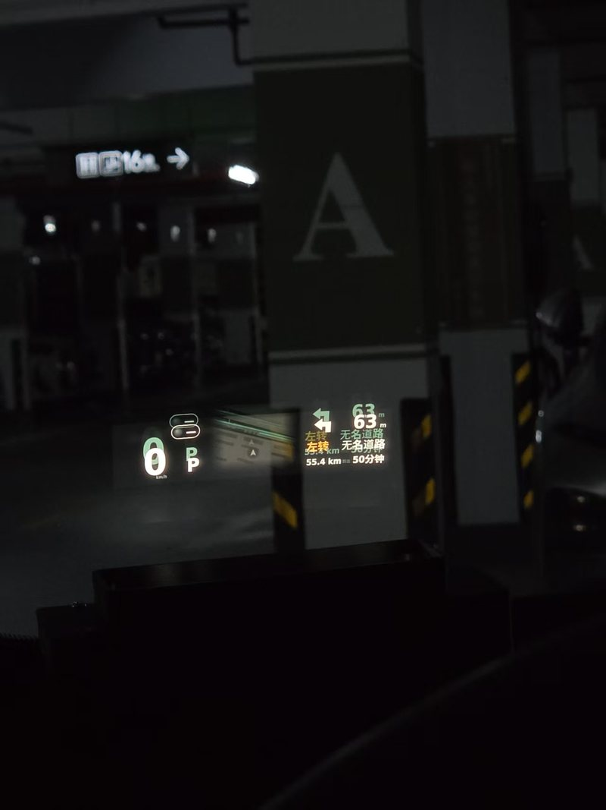

# 车机导航数据：怎么拿，以及为什么会把车机拖慢

> 导航数据不是从屏幕截图或 UI 自动化拿的，是**直接绑定厂商导航服务的 Binder**。
> 这条路能拿到结构化 TBT（下一步动作/距离/路名）和红绿灯倒计时，但**轮询方式不对会把车机导航拖卡**。
> 下面把链路和踩过的坑都写清楚。

## 1. 数据链路

```
车机导航 App（com.sgm.navi.hmi）
   └─ MapService（com.sgm.navi.exportservice.MapService）
        └─ IBinderPool ── code 29 = NAVI_AUTO_API
             ▲
             │ #BINDSVC / #NAV（ShellBridge，TCP 7801）
             │
        CastSink · NavPush（CarBus 常驻链路，2.5s 一轮）
             │ HTTP POST /nav
             ▼
        Pi · car_pull.py（:8899）──► HUD 渲染
```

红绿灯倒计时走另一条回调：`INaviAutoCountDownLightCallback`（`RouteCb.kt`，transact code 3）。

## 1.1 效果



地库无 GPS，TBT 仍能显示（数据来自 Binder 回调，不依赖定位）。

## 2. 关键命令

```bash
# 一次性探测：绑定服务并打印 binder 信息（5s 超时）
printf '#NAV\n' | nc $CAR_HOST 7801

# 常驻用法：绑定 NAVI_AUTO_API 并拉一次 TBT
printf '#BINDSVC com.sgm.navi.hmi com.sgm.navi.exportservice.MapService 4 s:com.vox.castsink s:NAVI_AUTO_API -- 29 s:com.vox.castsink\n' | nc $CAR_HOST 7801
```

## 3. 会让车机导航变慢的坑（重点）

下面每一条都是我们实际改过的：

| # | 坑 | 后果 | 现在的做法 |
| --- | --- | --- | --- |
| 1 | **每次查询都 `bindService`** | 绑定/解绑要走系统服务与 App 主线程调度，高频绑定时导航 App 明显掉帧 | 改成 **CarBus 单例常驻链路**，只绑一次复用（`NavPush.kt` v130） |
| 2 | **每次查询新建 Socket** | 连接风暴，车机侧 accept/回收开销叠加 | 同样并入 CarBus，不再自建连接（v130） |
| 3 | **1 秒一轮轮询** | 每秒一次跨进程 transact + 序列化，导航 App 的 Binder 线程被持续占用 | 周期改为 **2500 ms**（v113 起） |
| 4 | **每秒开 `#GPS` 取坐标** | 又多一条 socket + 解析 | 改读 `VehicleState` 内存坐标（v113） |
| 5 | **结果过期还推** | 车机已经忙到往返 >1.5s，再推只会继续加重 | **新鲜度闸门**：往返 >1500 ms 直接丢弃并记日志 |
| 6 | **payload 没变还推** | 无意义 HTTP 与 Pi 侧解码 | 与上次相同则跳过（去重） |
| 7 | **`#NAV` 放进高频循环** | 它有 **5 秒**的 bind latch，会把处理线程卡住 | `#NAV` 只用于人工探测；循环里用 `#BINDSVC` |
| 8 | **在回调里做重活** | 导航 App 的回调线程被我们拖住 | 回调只拷 Parcel，处理放到自己的线程 |

## 4. 实测参数（照这个来，别更激进）

| 参数 | 值 | 出处 |
| --- | --- | --- |
| TBT 轮询周期 | 2500 ms | `NavPush.kt` |
| 新鲜度上限 | 1500 ms（超过即丢） | `NavPush.kt` v130 |
| `#BINDSVC` 查询超时 | 1500 ms（Pi 侧）/ 2500 ms（`car_pull`） | `car_pull.py` / `NavPush` |
| `#NAV` 绑定等待 | 5 s | `ShellService.java` |
| 红绿灯轮询 | 2 s | `car_pull.py` |

## 5. 不该做的事

- ❌ **UI 自动化/截图识别**导航：更慢，且导航 App 一切换主题就废。
- ❌ **高频 logcat 抓导航**：日志本身是同步写，抓得越勤越卡。
- ❌ **同时开多条查询链路**（NavPush + car_pull 都在拉）：默认只保留一条。

## 6. 怎么判断是不是我们把车机拖慢了

1. 看日志里的 `cost`：`NavPush` 会在超过 1500 ms 时打印 `stale: cost=...ms`。
2. 临时停掉 NavPush，观察导航 App 是否恢复流畅——这是最直接的对照。
3. 把周期从 2500 ms 调到 5000 ms 再测，若明显改善，说明瓶颈在轮询频率。

## 7. 已知限制

- 依赖厂商包名与 binder 事务码（`com.sgm.navi.hmi` / code 29 / code 3），**不同车型会变**，需要重新反查。
- TBT 字段是厂商私有 JSON，字段名以 `map/routeName/remainDist` 为例，换供应商要重映射。
- 没有官方文档，全部来自实测与反编译。